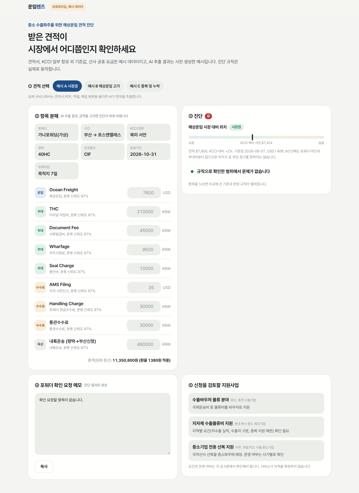

# 운임렌즈 (Unim Lens)

**해상운임 견적서를 받았을 때 "얼마인가"보다 먼저 "어디까지 포함한 금액인가"를 확인하도록 돕는 웹 서비스입니다.**

중소 수출기업 담당자가 포워더 견적을 붙여넣거나 파일로 올리면, AI가 항목과 조건을 원문 그대로 읽어 내고, 공개 운임지수(KCCI)와 공표운임으로 비교 기준을 보여 주며, 차이가 나는 부분을 포워더에게 물어볼 질문으로 정리합니다.

2026 해운항만물류 AX 혁신 아이디어 공모전(물류 AX 트랙) 출품작입니다.

**[서비스 열기](https://unim-lens.vercel.app)** / [중복과 누락 예시 바로 보기](https://unim-lens.vercel.app/?q=dupMissing)

| 결과 요약 | 근거와 원문 | 포워더 질문 |
|---|---|---|
|  |  |  |

---

## 무엇을 하나요

| 단계 | 사용자가 하는 일 | 화면에 보이는 것 |
|---|---|---|
| 1. 견적 입력 | 견적 글을 붙여넣거나 이미지, PDF를 올림 (예시 견적 3종도 선택 가능) | 외부 AI 전송 동의 후 AI가 항목을 읽음 |
| 2. 항목 확인 | 읽힌 항목과 금액을 원문과 나란히 확인하고 고침 | 읽지 못한 칸, 확인이 필요한 조건 표시 |
| 3. 비교 | 결과를 봄 | KCCI와 비교할 수 있는 비용만 골라 계산한 차이, 공표운임 참고 목록 |
| 4. 근거 보기 | 항목을 누름 | 판단 근거, 견적 원문, 비교 기준 |
| 5. 질문 | 문장을 고쳐서 복사 | 포워더에게 보낼 질문 |

AI는 **읽기**만 맡습니다. 금액을 만들거나 합산하지 않고, 합계와 비교는 정해진 규칙 코드가 계산하므로 같은 견적이면 결과가 매번 같습니다.

## 실제로 확인한 결과 (2026-10-30)

| 항목 | 결과 | 기록 |
|---|---|---|
| AI 견적 읽기 (합성 견적 23건: 글 15, PNG 5, PDF 3) | 항목 재현율 97.9%, 금액 정확 일치 96.4%, 지어낸 금액 0건 | [실측 기록](docs/research/06-extraction-benchmark.md) |
| 공표운임 API (data.go.kr 15029607) | 부산발 9개 구간 모두 조회일 기준 3일 이내 공표 확인 | [실측 기록](docs/research/06-extraction-benchmark.md) |
| 자동 테스트 | 43개 통과 (`node --test tests/`) | [tests/](tests) |

합성 견적은 직접 만든 시험용 견적입니다. 실제 고객 견적으로 잰 정확도는 아직 없습니다.

## 구조

```
브라우저 (prototype/index.html, app.js)
 ├─ 규칙 계산: 합계, KCCI 비교, 중복과 누락 진단, 질문 문장
 ├─ /api/extract  → OpenAI Responses API (gpt-5-mini, JSON 스키마 구조화 출력)
 └─ /api/tariff   → data.go.kr 해양수산부_화물운임공표정보 (XML)
```

| 경로 | 역할 |
|---|---|
| `prototype/` | 정적 웹 화면과 규칙 계산 (Vercel Root Directory) |
| `prototype/api/extract.js` | 견적 글, 이미지, PDF를 AI로 읽기. 입력 제한과 호출 횟수 제한 포함 |
| `prototype/api/tariff.js` | 공표운임 조회. 최근 90일부터 찾고, 실패하면 사유를 화면에 표시 |
| `prototype/data.js` | 예시 견적 3종과 KCCI 값 (2026-10-26 발표, 수동 갱신) |
| `tests/` | 회귀 테스트와 정확도 측정 도구 (`tests/benchmark/`) |
| `docs/research/` | 주제 선정, 도메인 정리, 검증 근거, 배포와 실측 기록 |
| `docs/proposal/` | 아이디어 기획서 원고 |

## 직접 실행하기

화면만 볼 때는 정적 서버로 충분합니다. AI 읽기와 공표운임 조회는 서버 함수라서 Vercel 환경이 필요합니다.

```sh
python3 -m http.server 8768 --bind 127.0.0.1 --directory prototype
# 브라우저에서 http://127.0.0.1:8768
```

테스트는 Node.js 18 이상에서 외부 패키지 없이 돌아갑니다.

```sh
node --test tests/
```

서버 함수까지 쓰려면 Vercel에 아래 두 환경변수를 등록합니다. 키는 서버 함수에서만 읽고, 화면 코드에는 들어가지 않습니다.

| 변수 | 용도 |
|---|---|
| `OPENAI_API_KEY` | AI 견적 읽기 |
| `DATA_GO_KR_SERVICE_KEY` | 공표운임 조회 (15029607 활용신청 필요) |

`main`에 push하면 운영 배포, 다른 브랜치는 Preview 배포입니다.

## 데이터 출처

| 데이터 | 출처 | 이용 조건 |
|---|---|---|
| 컨테이너선 운임지수 KCCI | [한국해양진흥공사, data.go.kr 15131881](https://www.data.go.kr/data/15131881/fileData.do) | 무료, 이용허락범위 제한 없음 |
| 화물운임공표정보 | [해양수산부, data.go.kr 15029607](https://www.data.go.kr/data/15029607/openapi.do) | 무료, 이용허락범위 제한 없음 |
| 예시 견적, 환율, 부대요금 범위 | 직접 작성한 예시 | 실제 거래 자료 아님 |

## 아직 하지 않은 것

- 실제 고객 견적과 최종 청구 내역으로 정확도와 쓸모 측정 (참여 기업 모집 전)
- 공표운임을 비교 계산에 반영 (지금은 참고로만 표시)
- KCCI 자동 수집 (공식 API가 없어 수동 갱신)
- 별도 OCR, 견적 저장, 사용자 계정
- 견적은 40ft 1대 기준이며, 별도 할증료는 O/F에 포함되지 않았다고 가정합니다

## 더 읽기

- [아이디어 기획서](docs/proposal/proposal.md)
- [검증 근거와 범위](docs/research/04-verification-evidence.md)
- [화면 디자인과 배포 기록](docs/research/05-service-design-release.md)
- [정확도와 공표운임 실측 기록](docs/research/06-extraction-benchmark.md)
