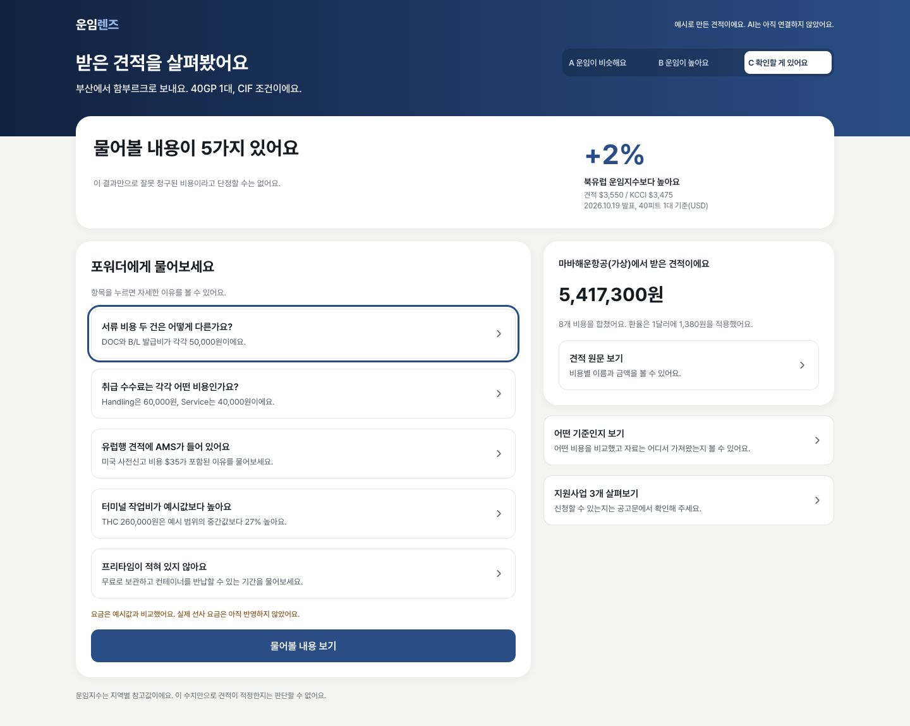
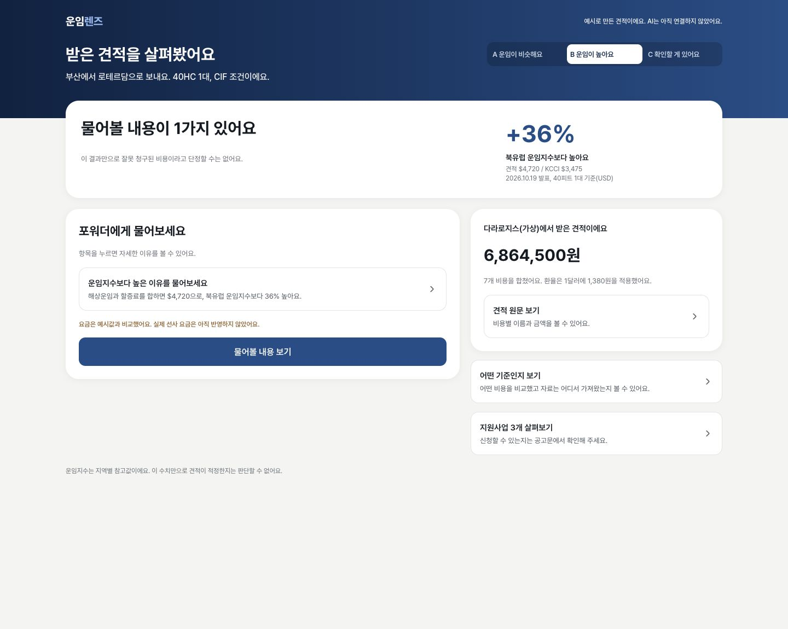

2026 해운/항만/물류 AX 혁신 아이디어 공모전, 아이디어 기획서

# 운임렌즈 (가칭)

받은 견적을 공공 운임 기준으로 읽어 줍니다

중소 수출화주가 포워더에게 받은 견적서를 올리면, AI가 항목을 나누고 KOBC 운임지수(KCCI)와 선사 공표 요금에 비춰 **시장 대비 위치**와 확인할 항목을 보여 주는 웹 서비스를 제안합니다. 현재 프로토타입의 요금 범위는 예시값이며, 실제 공표 요금 비교는 API 데이터 검증 후 구현할 계획입니다.

| 항목 | 내용 |
|---|---|
| 접수번호 | (미기재) |
| 참가자 성명 | 고기범 |
| 응모명 | 운임렌즈(가칭): KCCI와 선사 공표 요금으로 포워더 견적을 읽어 주는 중소화주용 AI 견적 진단 |
| 대표 Track | 물류 AX |
| 핵심 키워드 | 운임지수(KCCI), 견적 진단, 중소화주, 부대비용, 공공 데이터 |
| 프로토타입 | https://unim-lens.vercel.app (로그인 없이 열람) |

---

## 1. 개요

### 1.1 핵심내용 요약

| 문제 | 수출 중소기업의 59.3%가 물류 지원책을 써 본 적이 없고, 그중 55.1%는 제도를 몰랐습니다.[1] 소규모 화주는 운임 정보가 부족해 포워더가 제시한 가격에 의존합니다.[2] |
|---|---|
| 주요 사용자 | 전담 물류팀 없이 FCL로 수출하는 중소 제조기업의 수출 담당자 |
| 해결 | 견적서 업로드 → ① AI 항목 분해 → ② KCCI, 공표 요금과 비교 → ③ 중복 및 누락 점검 → ④ 포워더 확인 요청과 지원사업 안내 |
| 차별점 | 견적을 파는 쪽이 아니라 **공공 기준을 가진 KOBC가** 견적을 읽어 줍니다. 금액 비교와 판정은 결정적 코드가 맡고, AI는 견적 해석과 문장만 맡습니다 |
| 현재 상태 | 정적 웹 프로토타입 공개. 진단 규칙은 실제로 동작하며, 견적은 예시 데이터, AI 추출 결과는 사전 생성한 예시입니다. KCCI는 2026-10-19 발표값입니다[19] |
| PoC 목표 | 협력 화주 10개사 내외 *(가정)*, 3개월. 항목 분류 정확도, 협상 후 견적 변화, 지원사업 신청 전환을 측정합니다 |

- **59.3%** — 물류 지원책을 써 본 적 없는 수출 중소기업 비율 (2024)[1]
- **연 2.5만~40만 달러** — 해외 운임 벤치마크 서비스의 기업 구독료[7]
- **제한 없음** — 공공데이터포털 KCCI(15131881), 해양수산부 화물운임공표정보(15029607)의 이용허락범위 (2026-10-25 메타데이터 확인). 공표정보 API의 실제 응답과 요금 범위는 미검증입니다.[13][15]

### 1.2 배경 및 필요성

해상운임은 주 단위로 움직이고, 견적서에는 해상운임 외에도 이름이 제각각인 부대비용이 여럿 붙습니다. 중소화주는 받은 견적이 시장에서 어디쯤인지 판단할 기준이 없습니다. 민간 벤치마크는 비싸고[7], 국내 운임 플랫폼은 견적을 중개하거나 판매하는 쪽입니다.[8] 반면 중립적인 기준인 KCCI와 선사 공표 요금은 이미 공공 자산으로 있습니다.[9][13][15]

### 1.3 활용 Scene 및 기술

수출 담당자가 견적서 PDF나 엑셀을 올리면 LLM이 항목을 표준 코드로 분류합니다. 규칙 엔진이 해상운임을 KCCI 해당 권역과, 부대요금을 공표 요금과 비교하고, 중복과 누락을 점검합니다. 결과 화면에는 판정마다 견적값, 기준값, 출처가 함께 나오고, 포워더에게 보낼 확인 요청과 신청을 검토할 지원사업이 이어집니다.

### 1.4 기대효과

화주는 근거를 갖고 견적을 묻고 협상합니다. 예시 C에서 중복 여부를 확인할 B/L 발급비 50,000원, Service Charge 40,000원과 THC의 예시 요금 범위 중간값 대비 차이 55,000원을 수기로 합산하면 145,000원, 견적 총액 5,417,300원의 약 2.7%입니다 *(예시 계산이며 실제 절감액이 아닙니다. 화면은 항목별 진단만 제공합니다)*. KOBC는 자기 데이터를 화주의 실제 의사결정에 연결하고, 지원사업을 몰라서 놓치는 격차(55.1%)[1]를 견적 시점에 메웁니다.

---

## 2. 상세 내용

### 2.1 문제 정의 및 적용 대상

#### 문제: 견적은 받는데, 읽을 기준이 없습니다

| 근거 | 수치 | 출처 |
|---|---|---|
| 물류 지원책을 이용한 적 없는 수출 중소기업 (300개사 조사) | 59.3% | [1] |
| 그중 제도를 몰라서 이용하지 못한 비율 | 55.1% | [1] |
| 중소기업 전용 선복 지원사업 이용 경험 | 2.7% | [1] |
| 해외 운임 벤치마크 기업 구독료 | 연 2.5만~40만 달러 | [7] |
| KCCI 북유럽 운임 (2026-10-19, 40ft) | 3,475달러 | [19] |
| KCCI 북미 서안 운임 (2026-10-19, 40ft) | 8,229달러 | [19] |

**해상운임.** 견적과 KCCI를 비교하려면 적용 시점과 포함 비용을 맞춰야 합니다. KCCI는 기본운임(O/F)과 BAF, CAF, LSS, EBS 등 운임성 할증료를 포함하고, THC, DOC, WFG, Seal Charge 같은 현지 부대비용은 제외합니다.[20] 운임을 조회하는 플랫폼은 있지만, 이미 받은 견적을 중립 기준에 비춰 진단하는 도구는 확인하지 못했습니다.

**부대비용.** 견적서는 해상운임(O/F) 외에 할증료(BAF, LSS), 출발지 비용(THC, DOC, Wharfage, Seal), 포워더 수수료(Handling, EDI, AMS), 내륙운송과 통관 비용으로 나뉩니다. 문서 비용이 이름만 바꿔 중복 청구되는 사례가 해외에서 지적되고[6], 국내에서는 공정거래위원회가 한중 항로 선사들의 긴급유류할증료와 터미널 조작 수수료 등 부대비용 신규 도입 및 인상 담합을 확인한 바 있습니다.[16] *포워더 견적 단계의 국내 중복 청구 빈도는 확인하지 못했으며, PoC에서 측정합니다.* Demurrage, Detention처럼 견적에 없다가 나중에 청구되는 비용도 있습니다.

**지원사업.** 수출바우처 국제운송비 지원 한도는 2026년에도 6,000만 원입니다.[17] 그러나 지원사업은 부처와 지자체마다 흩어져 있고, 화주의 절반 이상이 제도를 모릅니다.[1]

#### 주요 사용자 *(아래 페르소나는 가정이며 인터뷰로 검증하지 않았습니다)*

**A. 중소 부품 제조사 수출 담당자.** 부산항에서 유럽과 미주로 연 수십 개 컨테이너를 FCL로 보냅니다. 물류 전담 인력 없이 영업 지원과 통관 서류를 함께 맡고, 견적은 포워더 2~3곳에서 받아 총액만 비교합니다.

**B. 처음 직수출을 시작한 소기업 대표.** 인코텀즈와 부대비용 항목이 낯설고, 어떤 지원사업을 신청할 수 있는지 모릅니다.

**C. 수출 지원기관 상담 창구.** 화주의 물류비 상담을 받지만 견적서를 항목별로 함께 읽어 줄 도구가 없습니다.

#### 기존 도구의 공백

| 기존 도구 | 하는 일 | 공백 |
|---|---|---|
| 운임 조회, 견적 중개 플랫폼[8] | 운임을 조회하거나 견적을 받아 줍니다 | 이미 받은 견적의 진단 기능은 확인하지 못했습니다. 중개와 진단의 이해충돌 가능성은 추가 검증이 필요합니다 |
| 해외 운임 벤치마크[7] | 대기업 대상 운임 데이터를 구독으로 팝니다 | 고가이며, 부대비용 점검과 국내 지원사업 연계가 없습니다 |
| KCCI 공개[9][10] | 매주 지수와 항로별 운임을 발표합니다 | 화주가 자기 견적과 맞춰 볼 방법이 없습니다 |

*국내 플랫폼에 견적 진단 기능이 있는지는 공개 자료로 확인하지 못했습니다.* 이용 의향 근거로 중소기업 86.2%가 온라인 운임 정보 시스템을 쓸 의향이 있다는 조사가 있으나[3], 플랫폼 사업자의 자체 조사이므로 참고 수치로만 씁니다.

**적용 범위.** 수출 FCL, 화주가 해상운임을 내는 조건(CIF, CFR 등)이 대상입니다. LCL은 국내 공개 운임지수가 확인되지 않아[12] 부대비용 진단까지만 다룹니다. 수입 화물, 항공, 장기운송계약 운임은 제외합니다.

---

### 2.2 접근 방식 및 핵심 아이디어

#### 민간 제공 유인에 대한 가설

| 이유 | 내용 |
|---|---|
| 지불 의사 | 벤치마크 구독료가 연 2.5만~40만 달러라는 제3자 자료가 있습니다.[7] 중소화주의 실제 지불 의사는 인터뷰로 확인해야 합니다 |
| 이해충돌 | 국내 운임 플랫폼은 견적을 중개하거나 판매합니다.[8] 진단 기능 제공에 어떤 영향을 주는지는 확인하지 못했습니다 |
| 기준 데이터 | KCCI와 화물운임공표정보는 공개 데이터이며 민간도 이용할 수 있습니다.[13][15] 공공기관의 운영이 신뢰에 도움이 되는지는 PoC에서 확인합니다 |

운임렌즈는 **KOBC가 자기 데이터를 화주의 결정에 바로 쓰이게 만드는 사업**으로 설계합니다. 주최 기관과의 적합성은 있지만, 공공 데이터 활용만으로 민간이 따라오기 어렵다고 볼 근거는 없습니다. 중립적인 설명과 지원사업 연결의 유용성을 실제 사용자에게 검증합니다.

#### 핵심 아이디어

1. **견적을 표준 항목으로 나눕니다.** 포워더마다 다른 항목명을 표준 코드(O/F, BAF, THC, DOC, Handling 등)로 묶습니다. 이 단계에만 LLM을 씁니다.
2. **공공 기준과 나란히 놓습니다.** 기본운임과 별도 청구된 KCCI 포함 할증료(BAF, CAF, LSS, EBS)를 합쳐 해당 권역 운임과 비교합니다.[20] 부대요금은 현재 예시 요금 범위로 동작을 시연하며, 실제 공표 요금 비교는 API 응답과 적용 범위를 검증한 뒤 구현합니다.[15] 결과는 "적정 운임"이 아니라 **시장 대비 위치**로만 표현합니다. 화면에는 비교 금액과 지수 대비 차이를 백분율로 보여 주고, +10%를 넘으면 이유를 묻는 항목을 표시합니다. 경계는 프로토타입 설정값입니다.
3. **판단 다음의 행동까지 잇습니다.** 확인할 항목마다 포워더에게 물을 질문을 만들고, 수출바우처 물류 분야, 지자체 수출물류비 지원, 중소기업 전용 선복 같은 지원사업을 안내합니다.

---

### 2.3 활용 시나리오 및 화면 구성

**시나리오 (가상).** 부산의 한 부품 제조사 수출 담당자가 함부르크행 40GP 견적을 받았습니다. 견적서에는 Documentation Fee와 B/L Issuance Fee, Handling Charge와 Service Charge가 따로 있고, 유럽 항로인데 AMS가 들어 있으며, 프리타임과 유효기간이 없습니다.

| 영역 | 내용 |
|---|---|
| ① 견적 선택 | 프로토타입은 예시 견적 A, B, C를 선택합니다. 견적서(PDF, 엑셀, 메일 본문) 업로드는 향후 구현할 계획입니다 |
| ② 결과 요약과 질문 | 물어볼 내용의 수와 KCCI 대비 차이를 먼저 보여 줍니다. 항목을 누르면 자세한 이유와 비교 기준을 별도 창에서 읽을 수 있습니다 |
| ③ 견적 원문 | 버튼을 누르면 선적 조건과 비용별 이름, 분류, 금액을 볼 수 있습니다. 금액을 고치면 합계와 확인할 내용이 바로 다시 계산됩니다 |
| ④ 확인 요청 | 질문을 모은 문장을 열어 수정하고 복사할 수 있습니다. 자동으로 발송하지 않습니다 |
| ⑤ 지원사업 | 상세 버튼으로 검토할 사업을 살펴봅니다. 자격은 확정하지 않고 공고 원문을 확인하도록 안내합니다 |


*그림 1. 예시 C의 결과. 서류 비용과 취급 수수료의 업무 구분, 유럽행 견적의 AMS, THC 산정 기준, 프리타임에 관해 물어볼 내용 5가지를 먼저 보여 줍니다. 유효기간 미기재는 견적 원문과 질문에 함께 안내합니다. 프로토타입 화면(예시 견적, AI 미연결).*


*그림 2. 예시 B의 결과. 기본운임 4,600달러와 LSS 120달러를 합친 비교 금액 4,720달러를 KCCI 북유럽 운임(3,475달러, 2026-10-19)과 비교해 +36%로 표시하고, 차이가 나는 이유를 묻도록 안내합니다. 프로토타입 화면(예시 견적).*

| 진단 | 판정 방식 |
|---|---|
| 해상운임 위치 | 기본운임과 별도 청구된 KCCI 포함 할증료를 같은 통화로 환산해 합산하고 해당 권역 40ft 운임과 비교합니다.[20] 실제 견적의 적용 주차, 장비, 수량, 포함 비용 정합성은 PoC에서 검증합니다. +10%, +25% 경계는 프로토타입 설정값입니다 |
| 부대요금 | 예시 요금 범위 중간값 대비 +10% 초과 시 표시합니다. 프로토타입 설정값이며 법적 허용 편차나 실제 공표 요금에 근거한 판정은 아닙니다 |
| 중복, 항로 불일치, 누락 | 같은 성격의 항목이 둘 이상인지, 사전신고 종류가 항로와 맞는지, 프리타임과 유효기간이 있는지를 규칙으로 봅니다 |

KCCI의 포함·제외 비용은 "어떤 기준인지 보기"에서 설명하고, 결과 요약에는 "잘못 청구된 비용이라고 단정할 수는 없어요"라는 안내를 둡니다. 포워더 마진이 일률적으로 제외된다는 근거는 확인하지 못했습니다. LCL 견적은 향후 운임 비교 없이 부대비용 점검만 제공할 계획입니다.

예시 A·C는 필요한 운임성 할증료가 O/F에 포함되었거나 별도 청구되지 않고, B의 LSS는 별도 청구된다고 가정합니다. 실제 견적의 포함·별도 여부를 확인해 이중 합산을 막는 절차는 아직 구현하지 않았습니다.

---

### 2.4 AI 및 데이터 활용, 구현 구조

#### LLM에 맡기지 않을 일부터 정했습니다

**LLM만 쓸 때의 위험**
- 견적에 없는 금액을 자연스럽게 만들어 냅니다
- 환율 환산과 합계를 틀립니다
- "적정 운임"을 근거 없이 단정합니다

**운임렌즈의 처리**
- LLM 출력은 정해진 스키마(JSON)로만 받고, 원문에 없는 금액이 나오면 버립니다
- 환산, 합계, 비교, 판정은 결정적 코드가 합니다
- 결과는 "시장 대비 위치"와 비교 기준으로만 표현합니다

| 단계 | 담당 | 이유 |
|---|---|---|
| 문서 텍스트 추출(OCR 포함) | 문서 파서 | 형식이 다양한 견적서를 읽습니다 |
| 항목명 분류, 통화와 단위 인식 | **LLM** | 제각각인 비정형 표현을 해석해야 합니다 |
| 환산, 합계, KCCI와 공표 요금 비교 | 결정적 코드 | 같은 입력이면 같은 결과가 나와야 합니다 |
| 중복, 누락 판정 | 결정적 규칙 | 근거를 설명할 수 있어야 합니다 |
| 확인 요청 문장, 결과 설명 | **LLM** | 규칙 결과를 문장으로 옮깁니다. 숫자는 코드가 넣은 값만 씁니다 |

```
[견적서] → [문서 파서] → [LLM 분류(스키마)] → [정규화: 코드, 통화, 단위]
   → [규칙 엔진] ← [KCCI 주간값, 선사 공표 요금, 지원사업 목록]
   → [진단 결과] → [LLM 설명, 확인 요청] → [화면]
```

#### 데이터

| 데이터 | 내용 | 확보 | 한계 |
|---|---|---|---|
| KCCI | 부산발 13개 항로, 40ft당 달러, 매주 월요일 발표. 공표운임 25%와 패널리스트(운송사업자 및 포워더) 계약운임 75% 반영[9][11] | 공공데이터포털(이용허락범위 제한 없음, 2026-10-25 확인)[13], 국가물류통합정보센터[10] | 권역 단위. O/F와 BAF, CAF, LSS, EBS 포함, THC, DOC, WFG, Seal Charge 제외[20] |
| 화물운임공표정보 | 공표번호와 항구코드로 업체, 항구, 통화, 요금정보 등을 조회하는 해양수산부 REST/XML API[15] | 공공데이터포털 15029607의 무료·이용허락범위 제한 없음 메타데이터 확인 | 실제 API 호출, 요금 종류별 범위, 항로 커버리지와 적재는 미검증입니다. 2020년 보도의 요금 8종[14]이 API에 모두 포함되는지도 확인해야 합니다 |
| 지원사업 목록 | 수출바우처 물류 분야, 지자체 수출물류비, 중소기업 전용 선복 등 | 공고문 정리 후 분기 갱신 | 요건이 해마다 바뀝니다 |
| 사용자 이력(PoC 이후) | 동의한 견적과 최종 청구 금액 | 사용자 업로드 | 비식별 처리와 동의가 전제입니다 |

항로별 시계열의 파일 형식은 PoC 착수 시 KOBC와 확정합니다. LLM은 LG CNS 또는 KOBC 표준 모델로 바꿔 끼울 수 있게 하나의 인터페이스로 분리하고, 견적서 원본은 진단이 끝나면 삭제하는 것을 기본값으로 둡니다.

---

### 2.5 실행 계획

#### 이미 된 것 (2026-10-25 기준)

| 항목 | 상태 |
|---|---|
| 정적 웹 프로토타입 | 공개 배포본 있음 (https://unim-lens.vercel.app), 데스크톱과 모바일 대응. 이번 비교 기준 정정은 로컬 반영 상태이며 재배포 전입니다 |
| 진단 규칙 | 해상운임 위치, 부대요금, 중복, 항로 불일치, 누락 5종이 브라우저에서 동작 |
| 기준 데이터 | KCCI 4개 항로 2026-10-19 발표값 반영.[19] 견적과 요금 범위는 예시값이며 실제 공표 요금은 적재하지 않았습니다 |
| 데이터 이용 조건 | KCCI(15131881)와 화물운임공표정보(15029607)의 이용허락범위 제한 없음 확인.[13][15] 공표정보 API 실제 응답·범위는 미검증입니다 |
| 실제 LLM 호출 | 미구현. 항목 추출은 사전 생성한 예시입니다 |

#### PoC에서 할 것

| 단계 | 기간 | 범위 | 산출물 |
|---|---|---|---|
| 1. PoC | 3개월 | KOBC 협력 화주 10개사 내외 *(가정)*, 부산발 FCL 주요 권역 | 실제 견적 진단, 분류 정확도와 사용성 측정 |
| 2. 시범 운영 | 6개월 | 수출 지원기관 상담 창구 연계, LCL 부대비용 진단 | 운영 지표, 규칙 개선 |
| 3. 확산 | 이후 | 국가물류통합정보센터 또는 KOBC 홈페이지 연계 | 공공 서비스로 상시 제공 |

PoC 1개월 차에 참여사 동의와 과거 견적 수집, 표준 코드표 확정, KCCI 적재를 마칩니다. 2개월 차에 실제 견적으로 진단을 운영하며 분류 오류를 고치고, 3개월 차에 협상 결과와 최종 청구 금액을 모아 지표를 측정합니다.

#### 인력 및 비용 *(추정)*

| 항목 | 규모 | 근거 |
|---|---|---|
| 기획 및 도메인 | 0.5명 | KOBC 운임지수 담당 부서 겸임을 가정. 규칙과 표준 코드 검수 |
| 개발(웹, 규칙 엔진, LLM 연동) | 1~2명 | 한 화면 구성과 규칙 엔진 규모 |
| 데이터 관리 | 0.5명 | 주간 KCCI, 분기별 공표 요금, 지원사업 목록 갱신 |
| 인건비 | 약 6,400만 원 *(직접인건비 추정)* | 2.5명 × 월 20.6일 × 3개월 ≈ 155인일 × 약 41.5만 원. SW기술자 일평균임금 2025년 396,307원[18]에 2026년 인상률 4.7%(제3자 게시 자료)를 적용했습니다. 외주 시 제경비와 기술료가 더해집니다 |
| LLM, 클라우드 | 소액 | 견적 1건당 분류 1회와 설명 1회. 10개사 규모에서 호출은 수백 건 수준 |
| 데이터 구입 및 관리 | 공개 데이터 제공은 무료, 운영비는 별도 산정 | KCCI와 화물운임공표정보의 무료 제공 메타데이터 확인.[13][15] 실제 데이터 확보·정규화·적재·관리 비용은 별도입니다 |

현재 비용 추정은 인건비 중심입니다. 공개 데이터의 무료 제공 조건은 확인했지만, 필요한 요금 범위의 확보와 운영 비용은 API 검증 후 보완합니다.

---

### 2.6 기대효과 및 성과 지표

#### QCD 관점 *(모두 추정이며 PoC에서 측정합니다)*

| 구분 | 화주 | KOBC 및 공공 |
|---|---|---|
| Q(품질) | 견적 항목의 뜻과 근거를 이해하고 계약합니다. 누락 비용을 미리 확인해 사후 청구 분쟁을 줄입니다 | KCCI가 실제 거래 판단에 쓰여 지수의 신뢰도와 인지도가 오릅니다 |
| C(비용) | 예시 C의 중복 여부 확인 대상인 B/L 발급비와 Service Charge(합계 90,000원), THC의 예시 요금 범위 중간값 대비 차이(55,000원)를 수기로 합산하면 145,000원, 총액 5,417,300원의 약 2.7%입니다 *(예시 계산이며 과다 청구나 절감액으로 확정한 금액이 아닙니다)*. 수출바우처(국제운송비 한도 6,000만 원)[17]처럼 몰라서 놓치는 지원을 줄입니다 | 공개 데이터의 무료 제공 조건을 활용하되 적재·관리 비용은 별도로 산정합니다 |
| D(시간) | 여러 견적을 항목 단위로 맞춰 보는 수작업을 줄입니다 | 지원사업 안내를 견적 시점에 붙여 상담 부담을 덜 수 있습니다 |

#### 성과 지표

| 지표 | 측정 방법 | 목표 |
|---|---|---|
| 진단 건수 | 시스템 로그 | 참여사당 월 4건 이상 *(가정)* |
| 항목 분류 정확도 | 담당자 검수 표본과 일치율 | 90% 이상 *(가정, 미달 시 사용자 확인 단계 강화)* |
| 사용자 이해도 | "견적을 이해하는 데 도움이 됐다" 응답 비율 | 70% 이상 *(가정)* |
| 누락 비용 사전 발견률 | 최종 청구서의 추가 항목 중 미리 알린 비율 | PoC에서 기준선 설정 |
| 협상 후 견적 변화율 | 진단 이후 견적이 수정된 비율과 금액 | PoC에서 기준선 설정 |
| 지원사업 신청 전환율 | 안내를 본 화주 중 실제 신청 비율 | PoC에서 기준선 설정 |

가정으로 둔 목표는 PoC 1개월 차 측정값으로 다시 정합니다. 측정 결과는 수치 그대로 보고합니다.

---

### 2.7 리스크 및 대응 방안

| 리스크 | 내용 | 대응 |
|---|---|---|
| 지수 해상도와 비용 범위 | KCCI는 권역 단위이며 O/F와 BAF, CAF, LSS, EBS를 포함하고 THC, DOC, WFG, Seal Charge를 제외합니다.[20] 견적과 포함 비용이 다르면 차이가 왜곡됩니다 | 포함 할증료를 합산하고 시점·장비·수량·포함 조건을 검증합니다. "시장 대비 위치"와 비교 한계를 밝히며 부당 청구로 단정하지 않습니다 |
| LCL 기준 부재 | 국내 LCL 운임지수를 확인하지 못했습니다[12] | LCL은 부대비용 진단만 제공한다고 명시합니다 |
| 포워더 반발 | KCCI 패널이 물류기업이라 공사가 마찰을 꺼릴 수 있습니다 | 고발이 아니라 질문을 돕는 도구로 설계합니다. 포워더 이름을 수집하거나 순위를 매기지 않고, "투명 견적" 표준 양식을 함께 검토합니다 |
| 가격 지도 오해 | 기관이 "적정 운임"을 제시하면 가격 지도로 보일 수 있습니다 | 공개 지수와 공표 요금만 쓰고 비교로만 표현합니다. 표현 기준은 사전에 법무 검토를 받습니다 |
| 공표 데이터 범위 | 정확한 데이터셋 15029607과 이용 조건은 확인했지만 API 응답, 요금 종류, 항로 커버리지, THC 및 NVOCC 포함 여부는 미검증입니다.[15] | 실제 API와 해운법·고시를 확인해 비교 대상을 확정합니다. 그전까지 프로토타입 요금 범위는 예시임을 표시합니다 |
| AI 분류 오류 | 항목을 잘못 분류하면 중복 판정이 틀립니다 | 스키마 검증, 신뢰도 낮은 항목의 사용자 확인, 수정 시 재계산 |
| 민간 추격 | 운임 플랫폼도 공개 데이터를 이용해 비슷한 기능을 붙일 수 있습니다 | 기관의 중립적 설명과 지원사업 연결이 사용자에게 차별점이 되는지 PoC에서 검증합니다 |
| 영업정보 | 견적서에는 거래처와 단가가 담깁니다 | 원본은 진단 후 삭제가 기본값이고, 이력 저장은 별도 동의와 비식별 처리를 거칩니다 |
| 지원사업 정보 노후화 | 요건과 예산이 해마다 바뀝니다 | 공고 원문 링크를 함께 주고 자격을 확정하지 않습니다. 분기마다 갱신합니다 |

---

## 선택 제출자료 안내

| 자료 | 내용 |
|---|---|
| 제출 여부 및 형태 | 제출, 웹페이지(URL) |
| 프로토타입 URL | https://unim-lens.vercel.app |
| 사용 안내 | 로그인과 설치 없이 예시 견적 3종을 불러와 볼 수 있습니다. 견적은 예시 데이터, AI 추출 결과는 사전 생성한 예시이며, 진단 규칙은 브라우저에서 실제로 실행되어 금액을 고치면 판정이 바뀝니다. KCCI는 북미 서안, 북미 동안, 북유럽, 지중해 4개 항로의 2026-10-19 KOBC 발표값[19]입니다. 비교 금액은 기본운임과 KCCI 포함 할증료의 합계이고, 요금 범위는 모두 예시값입니다. 실제 공표 요금 적재와 LCL 견적은 포함하지 않았습니다 |

---

## 참고문헌

1. 중소기업중앙회 수출 중소기업 물류 애로 조사(2024), 뉴데일리 보도 — https://biz.newdaily.co.kr/site/data/html/2024/07/14/2024071400022.amp.html
2. 소규모 화주 운임 비교 플랫폼 연구(2024) — https://koreascience.or.kr/article/CFKO202433161622440.pdf
3. 트레드링스, 중소기업 86.2% 온라인 운임 정보 이용 의향 — https://www.tradlinx.com/blog/?p=4906
4. DHL, LCL 운임 비용 요인 — https://www.dhl.com/kr-ko/home/global-forwarding/freight-forwarding-education-center/the-cost-drivers-of-lcl-rates.html
5. LCL 보세창고 배정 구조 연구(2010) — https://koreascience.or.kr/article/JAKO201020733098131.pdf
6. iContainers, 포워더 부대비용 항목 — https://www.icontainers.com/guides/freight-forwarder-fees-and-charges/
7. Xeneta 가격(제3자 프로필) — https://us.fitgap.com/products/xeneta
8. 첼로스퀘어 LCL 운임 조회 — https://www.cello-square.com/kr/service/view-103.do / 트레드링스 견적 — https://www.tradlinx.com/blog/?p=3751
9. KCCI 산출 방식 — https://www.forwarder.kr/freight/index/kcci / 패널 확대 — https://www.fnnews.com/news/202511131858300730
10. 해진공 운임지수, 국가물류통합정보센터 제공(2026-06) — https://www.heraldk.com/article/2026061116235174280
11. KCCI 6주 연속 상승(2026-09) — https://news.tf.co.kr/read/ogmeta/2363758.htm
12. LCL 운임 구조 일반 자료(국내 지수 미확인) — https://www.marineinsight.com/maritime-law/what-is-cbm-rate-in-shipping/
13. 공공데이터포털 KCCI 메타데이터 — https://www.data.go.kr/biz/dcat/metadata/15131881.do
14. 288가지 컨테이너 해상운임 공개(2020) — https://newstomato.com/ReadNews.aspx?no=980802
15. 해양수산부_화물운임공표정보(15029607) — https://www.data.go.kr/data/15029607/openapi.do / [원문 검증 및 기존 15133134 오인 정정 기록](../research/04-verification-evidence.md)
16. 공정위, 한중 항로 선사 운임 및 부대비용 담합 시정명령(2022) — https://biz.newdaily.co.kr/site/data/html/2022/06/09/2022060900055.html
17. 중기부, 2026 수출지원 6,867억 편성(수출바우처 국제운송비 한도 6,000만 원) — https://news.tf.co.kr/read/economy/2271015.htm
18. SW기술자 일평균임금 2025년 396,307원 — https://byline.network/2024/12/4-249/
19. KOBC KCCI 공식 표(2026-10-19 항로별 운임 대조) — https://kobc.or.kr/ebz/shippinginfo/kcci/gridList.do?mId=0304000000 / 기존 인용 보도 — https://www.kukinews.com/article/view/kuk202610190239
20. KOBC KCCI 산출 기준(Standards) 2쪽, 포함·제외 비용 — https://kobc.or.kr/ebz/common/file/KCCI_Standards.pdf / [출처 검증 기록](../research/04-verification-evidence.md)
