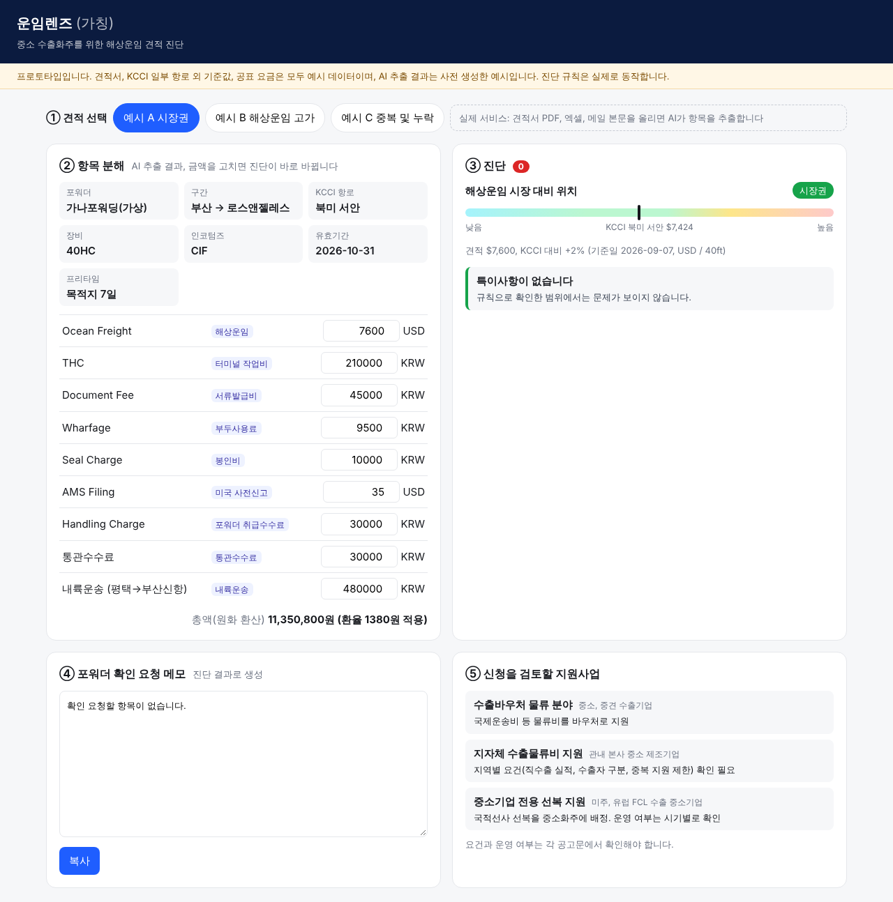
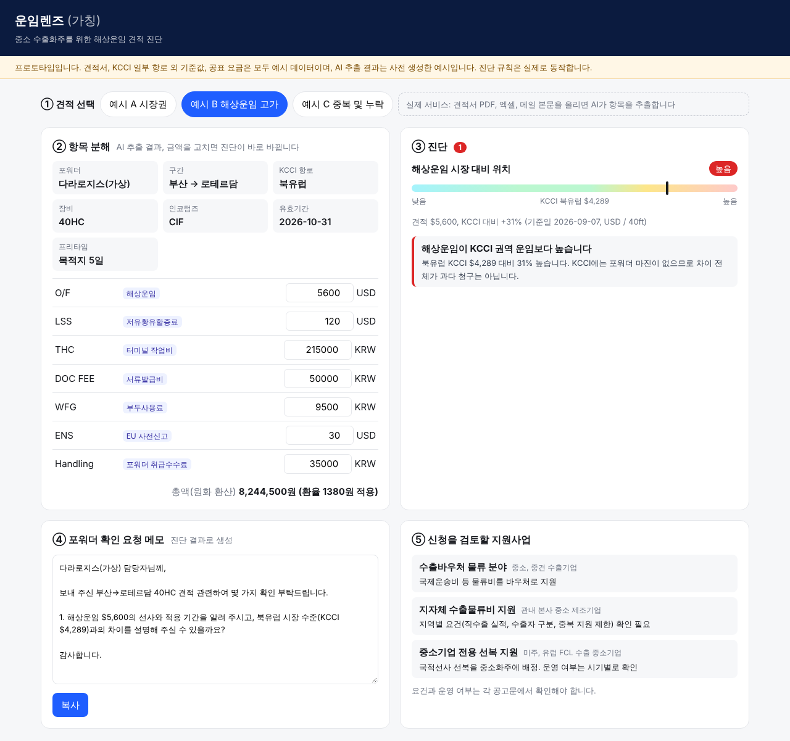
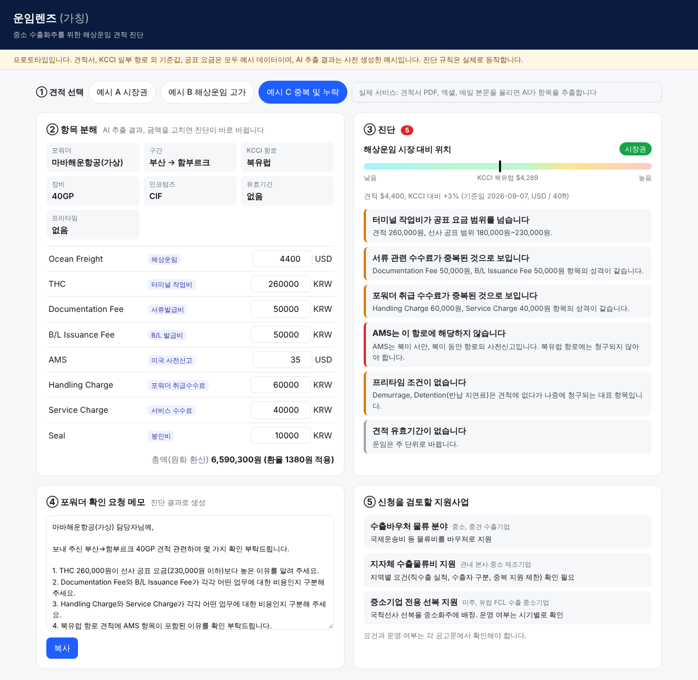

# 운임렌즈(가칭): 중소 수출화주를 위한 해상운임 견적 진단 서비스

| 항목 | 내용 |
|---|---|
| 응모명 | 운임렌즈(가칭): KCCI와 선사 공표요금으로 포워더 견적을 읽어 주는 중소화주용 AI 견적 진단 |
| 대표 Track | 물류 AX |
| 핵심 키워드 | 운임지수(KCCI), 견적 진단, 중소화주, 부대비용, 공공 데이터 |
| 참가 형태 | 개인 |

---

## 1. 개요

### 1.1 핵심내용 요약

운임렌즈는 중소 FCL 수출화주가 포워더에게 받은 견적서를 올리면, AI가 견적을 항목별로 분해하고 KOBC가 매주 발표하는 KCCI(권역별 40ft당 달러)[11]와 선사가 PORT-MIS에 공표한 요금[14]에 비춰 **시장 대비 위치**를 보여 주는 서비스다. 중복 청구가 의심되는 부대비용과 견적에서 빠지기 쉬운 비용을 짚고, 포워더에게 물어볼 협상 질문과 신청할 수 있는 지원사업을 함께 제시한다. 금액 비교, 환산, 합계, 중복 판정은 결정적 코드가 맡고, AI는 비정형 견적서 해석과 항목 분류, 설명 문장만 맡는다. LCL 견적은 공개 운임지수가 확인되지 않아[12] 부대비용 진단까지만 다룬다.

### 1.2 배경 및 필요성

2024년 중소기업중앙회 조사에서 수출 중소기업의 59.3%가 물류 지원책을 이용한 적이 없었고, 그중 55.1%는 제도를 몰랐다. 중소기업 전용 선복 지원사업 이용 경험은 2.7%에 그쳤다.[1] 소규모 화주는 운임 정보가 부족해 포워더가 제시한 가격에 의존하는 구조이며[2], 해외 운임 벤치마크 서비스는 연 2.5만~40만 달러 수준이라[7] 중소화주가 쓰기 어렵다. 반면 중립적 기준이 되는 KCCI와 선사 공표요금은 이미 공공 자산으로 존재한다.[9][13][15]

### 1.3 활용 Scene 및 기술

수출 담당자가 견적서 PDF나 엑셀을 올리면 ① LLM이 항목을 추출해 표준 코드로 분류하고 ② 규칙 엔진이 O/F를 KCCI 해당 권역과, 부대요금을 공표요금과 비교하며 ③ 중복과 누락 규칙을 점검한 뒤 ④ 협상 메모와 지원사업 안내를 한 화면에 보여 준다. 판정 근거가 되는 숫자와 출처는 항목마다 함께 표시한다.

### 1.4 기대효과

화주는 견적 한 건을 몇 분 안에 이해하고 근거를 갖고 협상할 수 있다(*추정*). KOBC는 자기 데이터를 화주의 실제 의사결정에 연결해 공공 데이터의 활용도를 높이고, 지원사업 인지도 격차(55.1%)[1]를 견적 시점에 직접 메울 수 있다. PoC 성과는 진단 건수, 협상 후 견적 변화율, 지원사업 신청 전환율로 측정한다.

---

## 2. 상세 내용

### 2.1 문제 정의 및 적용 대상

#### 문제 1. 화주는 받은 견적이 시장에서 어디쯤인지 모른다

해상운임은 시장 상황에 따라 크게 움직인다. KCCI 기준으로 2026년 9월 7일 북미 서안 항로는 40ft당 7,424달러, 북유럽 항로는 4,289달러였다.[11] 같은 시기에 받은 견적이라도 이 숫자와 비교해 보지 않으면 화주는 비싼지 싼지 판단할 근거가 없다. 소규모 화주는 정보가 부족해 포워더가 제시한 가격에 의존하며, 선사별 운임을 비교해 주는 플랫폼은 연구 단계의 제안으로만 확인된다.[2]

#### 문제 2. 부대비용은 항목이 많고 이름이 제각각이다

견적서는 해상운임(O/F) 외에 할증료(BAF, LSS 등), 출발지 비용(THC, DOC, Wharfage, Seal), 포워더 수수료(Handling, EDI, AMS), 내륙운송과 통관 비용으로 나뉜다. 포워더마다 같은 성격의 비용을 다른 이름으로 부르고, DOC, EDI, AMS 같은 문서 비용이 중복으로 청구되는 사례가 해외에서 지적된다.[6] *(국내 실태는 확인 전이다.)* LCL 견적은 FCL보다 항목이 더 많고[4], 보세창고를 포워더가 배정하기 때문에 화주는 창고료를 고를 수 없다.[5] 또한 Demurrage, Detention처럼 견적에는 없다가 나중에 청구되는 비용이 있다.

#### 문제 3. 쓸 수 있는 지원사업을 모른다

수출 중소기업의 59.3%가 물류 지원책을 이용한 적이 없고, 이 중 55.1%는 제도를 몰라서였다. 중소기업 전용 선복 이용 경험은 2.7%였다.[1] 지원사업은 부처와 지자체마다 흩어져 있어, 견적을 받는 시점에 화주가 스스로 찾아보기 어렵다.

#### 적용 대상

| 구분 | 내용 |
|---|---|
| 주 사용자 | 부산항 등 국내 항만에서 FCL로 수출하는 중소 제조기업의 수출입 담당자. 전담 물류팀이 없고, 여러 업무를 겸하며, 견적을 2~3곳에서 받아 비교하는 수준을 가정한다 *(페르소나는 가정이며 인터뷰로 검증하지 않았다)* |
| 보조 사용자 | LCL 화주(부대비용 진단만 제공), 수출 지원기관 상담 창구 |
| 대상 거래 | 수출 FCL, 화주가 해상운임을 부담하는 조건(CIF, CFR 등). FOB 수출이면 해상운임은 바이어 부담이므로 출발지 부대비용 진단만 의미가 있다 |
| 제외 범위 | 수입 화물, 항공, 장기운송계약 운임의 적정성 판단 |

이용 의향에 관해서는 중소기업의 86.2%가 온라인 운임 정보 시스템을 쓸 의향이 있다는 조사가 있다.[3] 다만 이 조사는 운임 플랫폼 사업자의 자체 조사이므로 참고 수치로만 쓴다.

---

### 2.2 접근 방식 및 핵심 아이디어

#### 왜 기업이 만들지 않는가

이 문제는 수요가 있는데도 민간이 풀지 않는다. 이유는 세 가지다.

| 이유 | 내용 |
|---|---|
| 지불 의사 | Xeneta 같은 운임 벤치마크는 기업 구독료가 연 2.5만~40만 달러다.[7] 중소화주는 이 비용을 내기 어렵다 |
| 이해충돌 | 국내 운임 플랫폼은 포워딩 견적을 중개하거나 직접 판매한다.[8] 포워더 견적을 감사하는 도구를 낼 유인이 약하다 |
| 기준 데이터 | 중립적인 운임 기준(KCCI, 선사 공표요금)은 공공이 가진다.[9][14] KCCI는 2026년 6월부터 국가물류통합정보센터에서도 제공된다[10] |

따라서 이 서비스는 **중립 기관인 KOBC가 자기 데이터를 화주의 의사결정에 바로 쓰이게 만드는 사업**으로 설계한다. 이것이 공모전 주최 기관과의 적합성이자, 민간이 따라오기 어려운 구조적 차별점이다.

#### 핵심 아이디어 세 가지

1. **견적을 표준 항목으로 분해한다.** 포워더마다 다른 항목명을 표준 코드(O/F, BAF, THC, DOC, Handling 등)로 묶는다. 이 단계에서만 LLM을 쓴다.
2. **공공 기준과 나란히 놓는다.** O/F는 KCCI 해당 권역 운임과, 부대요금은 선사 공표요금(서류발급비, 부두사용료 등 8종)[14]과 비교한다. 결과는 "적정 운임"이 아니라 **"시장 대비 위치"**(지수보다 낮음, 비슷함, 높음)로만 표현한다.
3. **판단 다음의 행동까지 잇는다.** 의심 항목마다 포워더에게 물어볼 질문을 만들고, 화주 조건에 맞는 지원사업(물류바우처, 지자체 수출물류비 지원, 중소기업 전용 선복)을 안내한다.

#### 차별점 정리

| 비교 대상 | 하는 일 | 운임렌즈와의 차이 |
|---|---|---|
| 운임 조회, 견적 중개 플랫폼[8] | 견적을 받거나 운임을 조회한다 | 이미 받은 견적을 진단하지 않고, 중개 사업자라 중립적이지 않다 |
| 해외 운임 벤치마크[7] | 대기업 대상 운임 데이터 구독 | 고가이며 부대비용 중복 점검과 국내 지원사업 연계가 없다 |
| KCCI 단독 공개[9] | 지수 숫자를 발표한다 | 화주가 자기 견적과 직접 맞춰 볼 방법이 없다 |

*국내 운임 플랫폼에 견적 감사 기능이 있는지는 공개 자료로 확인하지 못했다. 위 비교는 공개된 서비스 소개에 근거한다.*

---

### 2.3 활용 시나리오 및 화면 구성

프로토타입은 설치와 로그인 없이 쓰는 정적 웹이다. 모든 견적서는 **예시 데이터**이며, AI 추출 결과는 **사전 생성한 예시**를 넣었다. 진단 규칙은 브라우저에서 실제로 실행되므로 금액을 고치면 판정이 바로 바뀐다. 예시 견적은 정상, 해상운임 고가, 부대비용 중복 및 누락의 세 종류다.

#### 시나리오

부산의 한 중소 부품 제조사(가상) 수출 담당자가 북유럽행 40ft 1대에 대해 포워더 견적을 받았다. 견적서에는 O/F와 함께 DOC, EDI, Handling, Documentation Fee가 따로 적혀 있고, Detention 조건은 없다. 담당자는 이 견적이 적당한지, 무엇을 물어봐야 하는지 알고 싶다.

#### 화면 1. 견적 업로드


*화면 1. 견적서(PDF, 엑셀, 이미지)를 올리고 출발항, 도착 권역, 컨테이너 규격, 인코텀즈를 선택한다. 예시 견적 3종을 바로 불러올 수 있다.*

담당자는 견적서 파일을 끌어다 놓고 출발항(부산), 도착 권역(북유럽), 규격(40ft), 인코텀즈(CIF)를 고른다. 화면 상단에는 "프로토타입, 예시 데이터"를 표시한다.

#### 화면 2. 항목 분해 표


*화면 2. 원문 항목명, 표준 코드, 통화, 단위, 금액이 표로 정리된다. AI가 분류한 항목에는 신뢰도와 원문 위치가 붙는다.*

견적서의 각 줄이 표준 코드로 분류된다. 예를 들어 "Documentation Fee"와 "DOC"는 같은 서류 비용 코드로 묶인다. 담당자는 분류가 틀린 항목을 직접 고칠 수 있고, 고친 결과로 진단이 다시 계산된다.

#### 화면 3. 진단


*화면 3. O/F 게이지(KCCI 권역 운임 대비 위치), 부대요금 비교(선사 공표요금 대비), 중복 및 누락 의심 목록.*

| 영역 | 보여 주는 것 | 판정 방식 |
|---|---|---|
| O/F 게이지 | 견적 O/F를 같은 주 KCCI 해당 권역 40ft 운임과 나란히 표시하고 낮음, 비슷함, 높음으로 구분 | 결정적 계산. 구간 경계는 설정값이며 PoC에서 조정한다 |
| 부대요금 비교 | DOC, 부두사용료 등을 선사 공표요금과 비교 | 공표값의 허용 편차(±10%)[15]를 참고한 결정적 규칙 |
| 중복 의심 | 같은 표준 코드에 두 개 이상 항목이 있으면 표시 | 결정적 규칙 |
| 누락 가능 | Detention 조건, 내륙운송 등 견적에 없는 항목을 알림 | 체크리스트 규칙 |

모든 판정 옆에는 비교에 쓴 기준값, 기준일, 출처를 함께 적는다. KCCI는 포워더 마진과 부대비용을 포함하지 않는 권역 지수이므로, 게이지 아래에 "지수와의 차이가 곧 부당 청구를 뜻하지는 않는다"는 안내를 고정으로 둔다.

#### 화면 4. 협상 메모 및 지원사업


*화면 4. 의심 항목별 포워더 확인 질문과, 화주 조건에 맞는 지원사업 목록.*

진단 결과를 바탕으로 "DOC와 Documentation Fee가 각각 청구되어 있는데 두 항목의 차이를 알려 주실 수 있을까요?", "Detention 무료 기간은 며칠인가요?" 같은 질문이 만들어진다. 질문 문장은 LLM이 쓰지만, 어떤 항목을 물을지는 규칙 엔진이 정한다. 아래에는 물류바우처, 지자체 수출물류비 지원, 중소기업 전용 선복 같은 사업을 소관 기관과 신청 경로 링크로 안내한다. 지원 요건과 금액은 사업 공고 원문으로 연결하고, 서비스가 자격을 확정하지 않는다.

#### LCL 견적의 경우

LCL은 국내 공개 운임지수가 확인되지 않아[12] O/F 게이지를 표시하지 않는다. 대신 CFS 비용, 창고료, 문서 비용의 중복 및 누락 점검과 협상 질문만 제공하며, 화면에 그 이유를 밝힌다.

---

### 2.4 AI 및 데이터 활용, 구현 구조

#### 설계 원칙: LLM에 맡기지 않을 일부터 정한다

| 단계 | 담당 | 이유 |
|---|---|---|
| 문서 텍스트 추출(OCR 포함) | 문서 파서 | 형식이 다양한 견적서를 읽기 위함 |
| 항목명 표준 코드 분류, 통화와 단위 인식 | **LLM** | 이름이 제각각인 비정형 표현을 해석해야 함 |
| 환율 환산, 단위 환산, 합계 | 결정적 코드 | 숫자는 재현 가능해야 함 |
| KCCI, 공표요금 비교와 위치 판정 | 결정적 코드 | 같은 입력이면 같은 결과가 나와야 함 |
| 중복, 누락 판정 | 결정적 규칙 | 근거를 설명할 수 있어야 함 |
| 협상 질문 문장, 결과 설명 | **LLM** | 규칙 결과를 읽기 쉬운 문장으로 옮김. 숫자는 코드가 넣은 값만 인용 |

LLM 출력은 정해진 스키마(JSON)로만 받고, 스키마를 벗어나거나 원문에 없는 금액이 나오면 버린다. 분류 신뢰도가 낮은 항목은 사용자에게 확인을 요청한다.

#### 구현 구조

```
[견적서 업로드] → [문서 파서] → [LLM 항목 분류(스키마 출력)]
        → [정규화: 표준 코드, 통화, 단위]
        → [규칙 엔진] ← [기준 데이터: KCCI 주간, 선사 공표요금, 지원사업 목록]
        → [진단 결과 JSON] → [LLM 설명, 협상 질문] → [화면]
```

#### 데이터

| 데이터 | 내용 | 수집 방법 | 한계 |
|---|---|---|---|
| KCCI | 부산발 13개 권역 항로, 40ft당 달러, 매주 발표. 공표운임 25%와 패널 운임 75% 반영[9][11] | 공공데이터포털(이용허락범위 "제한 없음"으로 검색됨)[13], 국가물류통합정보센터[10] | 권역 단위이며 항구 간 운임이 아니다. 마진과 부대비용을 포함하지 않는다 |
| 선사 공표운임 및 요금 | 2020년 7월부터 모든 항로의 운임 288종과 요금 8종(서류발급비, D/O 요금, 저유황유할증료, 부두사용료 등)을 연 4회 PORT-MIS에 공표[14] | PORT-MIS, 공공데이터포털[15] | 신고 기준이라 실제 운임과 다를 수 있다. 공표값은 최고와 최저의 평균이며 편차는 ±10% 이내[15] |
| 지원사업 목록 | 물류바우처, 지자체 수출물류비, 중소기업 전용 선복 등 | 공고문 수동 정리 후 주기적 갱신 | 요건이 해마다 바뀐다 |
| 사용자 이력(PoC 이후) | 화주가 동의한 견적과 최종 청구 금액 | 사용자 업로드 | 비식별 처리와 동의가 전제다 |

*KCCI의 항로별 시계열 제공 형태와 공공데이터포털 원문은 작성 환경의 네트워크 제한으로 직접 확인하지 못했으며, 제출 전에 확인한다.*

#### 기술 구성(PoC 기준)

웹 화면, 진단 API, 기준 데이터 저장소로 구성한다. LLM은 LG CNS 또는 KOBC가 쓰는 사내 표준 모델로 바꿔 끼울 수 있도록 분류와 설명 호출을 하나의 인터페이스로 분리한다. 견적서 원본은 진단이 끝나면 삭제하는 것을 기본값으로 둔다.

---

### 2.5 실행 계획

#### 단계

| 단계 | 기간 | 범위 | 산출물 |
|---|---|---|---|
| 0. 프로토타입 | 공모전 기간 | 예시 견적 3종, 사전 생성 AI 결과, 브라우저 규칙 엔진 | 공개 URL |
| 1. PoC | 3개월 | KOBC 협력 화주 10개사 내외, 부산발 FCL 주요 권역(북미, 유럽, 동남아) | 실제 견적 진단, 분류 정확도와 사용성 측정 |
| 2. 시범 운영 | 6개월 | 수출 지원기관 상담 창구 연계, LCL 부대비용 진단 확대 | 운영 지표, 규칙 개선 |
| 3. 확산 | 이후 | 국가물류통합정보센터 또는 KOBC 홈페이지 연계 서비스 | 공공 서비스로 상시 제공 |

#### PoC 시범 범위

- 대상: KOBC가 섭외할 수 있는 수출 중소기업 10개사 내외. 기업 수는 *가정*이며 섭외 여건에 따라 조정한다.
- 화물: 부산발 수출 FCL, KCCI가 다루는 권역 가운데 견적 빈도가 높은 3~4개 권역.
- 검증 질문: (1) LLM이 항목을 표준 코드로 얼마나 정확히 분류하는가, (2) 화주가 진단 결과를 이해하고 협상에 쓰는가, (3) 지원사업 안내가 실제 신청으로 이어지는가.

#### 일정(PoC 3개월)

| 월 | 할 일 |
|---|---|
| 1개월 | 참여사 섭외와 동의, 과거 견적 수집 및 비식별 처리, 표준 코드표와 규칙 확정, KCCI와 공표요금 적재 |
| 2개월 | 실제 견적으로 진단 운영, 분류 오류 수정, 주간 KCCI 갱신 자동화 |
| 3개월 | 협상 결과와 최종 청구 금액 수집, 지표 측정, 시범 운영 여부 판단 |

#### 인력 *(추정)*

| 역할 | 인원 | 근거 |
|---|---|---|
| 기획 및 도메인(해운 운임) | 0.5명 | KOBC 운임지수 담당 부서의 겸임을 가정. 규칙과 표준 코드 검수 |
| 개발(웹, 규칙 엔진, LLM 연동) | 1~2명 | 화면 4개와 규칙 엔진 규모라 소규모 팀으로 가능하다고 판단 |
| 데이터 관리(기준 데이터 갱신, 지원사업 목록) | 0.5명 | 주간 KCCI 갱신과 분기별 공표요금 갱신 |

#### 비용 *(추정)*

| 항목 | 3개월 PoC 추정 | 근거 |
|---|---|---|
| 인건비 | 위 인력 기준 내부 또는 외주 인건비 | 기관 단가에 따라 달라지므로 금액을 특정하지 않는다 |
| LLM 호출 | 소액 | 견적 1건당 분류 1회와 설명 1회 호출이며, 10개사 규모에서는 호출 수가 수백 건 수준으로 예상된다 |
| 클라우드 및 저장소 | 소액 | 정적 화면과 경량 API, 작은 기준 데이터 테이블로 구성된다 |
| 데이터 구입 | 없음 | KCCI와 공표요금 모두 공공 데이터를 쓴다[13][15] |

비용의 대부분은 인건비이며, 기준 데이터가 공공 자산이라 데이터 구입비가 들지 않는다는 점이 민간 벤치마크 서비스[7]와 가장 큰 차이다. 정확한 금액은 KOBC 내부 단가와 개발 방식(내부 개발 또는 외주)을 정한 뒤 산정한다.

---

### 2.6 기대효과 및 성과 지표

#### QCD 관점의 기대효과 *(모두 추정이며 PoC에서 측정한다)*

| 구분 | 화주 | KOBC 및 공공 |
|---|---|---|
| Q(품질) | 견적 항목의 의미와 근거를 이해한 뒤 계약한다. 누락 비용을 미리 확인해 사후 청구로 인한 분쟁을 줄인다 | KCCI가 실제 거래 판단에 쓰이며 지수의 신뢰도와 인지도가 오른다 |
| C(비용) | 근거를 갖고 질문해 불필요한 중복 청구를 줄일 여지가 생긴다. 지원사업을 몰라서 놓치는 경우를 줄인다 | 데이터 구입 없이 기존 공공 데이터로 서비스를 만든다 |
| D(시간) | 여러 견적을 항목 단위로 맞춰 보는 수작업을 줄인다 | 지원사업 안내를 견적 시점에 자동으로 붙여 상담 부담을 덜 수 있다 |

#### 성과 지표

| 지표 | 정의 | 측정 방법 | 목표 |
|---|---|---|---|
| 진단 건수 | PoC 기간 중 진단한 견적 수 | 시스템 로그 | PoC에서 기준선 설정 |
| 항목 분류 정확도 | 표준 코드 분류가 담당자 검수 결과와 일치한 비율 | 수작업 검수 표본 | PoC에서 기준선 설정 |
| 누락 비용 사전 발견률 | 최종 청구서에 추가된 항목 중 진단에서 미리 알린 비율 | 견적과 최종 청구 대조 | PoC에서 기준선 설정 |
| 협상 후 견적 변화율 | 진단 이후 포워더가 견적을 수정한 비율과 변화 금액 | 참여사 보고 | PoC에서 기준선 설정 |
| 지원사업 신청 전환율 | 안내를 본 화주 중 실제 신청한 비율 | 참여사 설문 | PoC에서 기준선 설정 |
| 사용자 이해도 | "견적을 이해하는 데 도움이 됐다"는 응답 비율 | 사용 후 설문 | PoC에서 기준선 설정 |

실측 자료가 없는 상태에서 목표 수치를 먼저 정하지 않는다. PoC 1개월 차에 기준선을 잡고, 시범 운영 단계의 목표는 그 결과로 정한다.

---

### 2.7 리스크 및 대응 방안

| 리스크 | 내용 | 대응 방안 |
|---|---|---|
| 지수 해상도 | KCCI는 13개 권역 수준의 지수이며 항구 간 견적과 바로 비교할 수 없다. 포워더 마진과 부대비용도 포함하지 않는다[9][11] | "적정가"가 아니라 "시장 대비 위치"로만 표시한다. 비교 기준과 한계를 화면에 고정으로 밝힌다 |
| LCL 기준 부재 | 국내 LCL 운임지수가 확인되지 않았다[12] | LCL은 부대비용 진단만 제공하고 운임 비교를 하지 않는다고 명시한다 |
| 포워더 반발 | KCCI 패널이 물류기업이며, 공사가 포워더와 마찰을 꺼릴 수 있다 | 비싼 곳을 고발하는 도구가 아니라 견적을 이해하고 질문하도록 돕는 도구로 설계한다. 개별 포워더 이름을 수집하거나 순위를 매기지 않는다. 포워더용 "투명 견적" 표준 양식을 함께 검토한다 |
| 담합 또는 가격 지도 오해 | 기관이 "적정 운임"을 제시하면 가격 지도로 보일 수 있다 | 공개 지수와 공표요금만 쓰고, 권고가 아닌 비교로 표현한다. 표현 기준은 사전에 법무 검토를 받는다 |
| 공표 데이터의 범위 | 공표 대상 요금 범위, 부대비용 포함 여부, 국제물류주선업자(NVOCC) 포함 여부가 아직 확인되지 않았다. 신고 기준이라 실제와 다를 수 있다[15] | 해운법 조문과 해양수산부 고시를 확인한 뒤 비교 대상 요금을 확정한다. 공표요금 비교는 참고 정보로 표시한다 |
| AI 분류 오류 | 항목명을 잘못 분류하면 중복 판정이 틀린다 | 스키마 검증, 신뢰도 낮은 항목의 사용자 확인, 원문 위치 표시, 사용자 수정 시 재계산 |
| 민간 경쟁사 추격 | 운임 플랫폼이 비슷한 기능을 붙일 수 있다 | 중개 사업자와의 이해충돌이 구조적이라 중립성은 따라오기 어렵다. 지원사업 연계는 공공이 더 잘할 수 있다 |
| 개인정보 및 영업정보 | 견적서에는 거래처, 단가 같은 영업정보가 담긴다 | 원본은 진단 후 삭제가 기본값이다. 이력 저장은 별도 동의를 받고 비식별 처리하며, 포워더 식별 정보는 저장하지 않는다 |
| 지원사업 정보 노후화 | 요건과 예산이 해마다 바뀐다 | 공고 원문 링크를 함께 제공하고 자격을 확정하지 않는다. 분기마다 목록을 갱신한다 |

---

## 선택 제출자료 안내

| 자료 | 내용 |
|---|---|
| 프로토타입 URL | TBD (제출 전 기입) |
| 사용 안내 | 로그인 없이 예시 견적 3종(정상, 해상운임 고가, 부대비용 중복 및 누락)을 불러와 볼 수 있다. 모든 견적은 예시 데이터이며 AI 추출 결과는 사전 생성한 예시다. 진단 규칙은 브라우저에서 실제로 실행되어 금액을 고치면 판정이 바뀐다. KCCI 값은 공개 보도에 나온 수치를 예시로 넣었다 |

---

## 참고문헌

1. 중소기업중앙회 수출 중소기업 물류 애로 조사(2024), 뉴데일리 보도 — https://biz.newdaily.co.kr/site/data/html/2024/07/14/2024071400022.amp.html
2. 소규모 화주 운임 비교 플랫폼 연구(2024) — https://koreascience.or.kr/article/CFKO202433161622440.pdf
3. 트레드링스, 중소기업 86.2% 온라인 운임 정보 이용 의향 — https://www.tradlinx.com/blog/?p=4906
4. DHL, LCL 운임 비용 요인 — https://www.dhl.com/kr-ko/home/global-forwarding/freight-forwarding-education-center/the-cost-drivers-of-lcl-rates.html
5. LCL 보세창고 배정 구조 연구(2010) — https://koreascience.or.kr/article/JAKO201020733098131.pdf
6. iContainers, 포워더 부대비용 항목 — https://www.icontainers.com/guides/freight-forwarder-fees-and-charges/
7. Xeneta 가격(제3자 프로필) — https://us.fitgap.com/products/xeneta
8. 첼로스퀘어 LCL 운임 조회 — https://www.cello-square.com/kr/service/view-103.do / 트레드링스 견적 — https://www.tradlinx.com/blog/?p=3751
9. KCCI 산출 방식 — https://www.forwarder.kr/freight/index/kcci / 패널 확대 — https://www.fnnews.com/news/202511131858300730
10. 해진공 운임지수, 국가물류통합정보센터 제공(2026-06) — https://www.heraldk.com/article/2026061116235174280
11. KCCI 6주 연속 상승(2026-09) — https://news.tf.co.kr/read/ogmeta/2363758.htm
12. LCL 운임 구조 일반 자료(국내 지수 미확인) — https://www.marineinsight.com/maritime-law/what-is-cbm-rate-in-shipping/
13. 공공데이터포털 KCCI 메타데이터 — https://www.data.go.kr/biz/dcat/metadata/15131881.do
14. 288가지 컨테이너 해상운임 공개(2020) — https://newstomato.com/ReadNews.aspx?no=980802
15. 운임공표제 안내 — https://www.tradlinx.com/blog/?p=1634 / 공표 운임 공공데이터 — https://www.data.go.kr/biz/dcat/metadata/15133134.do
